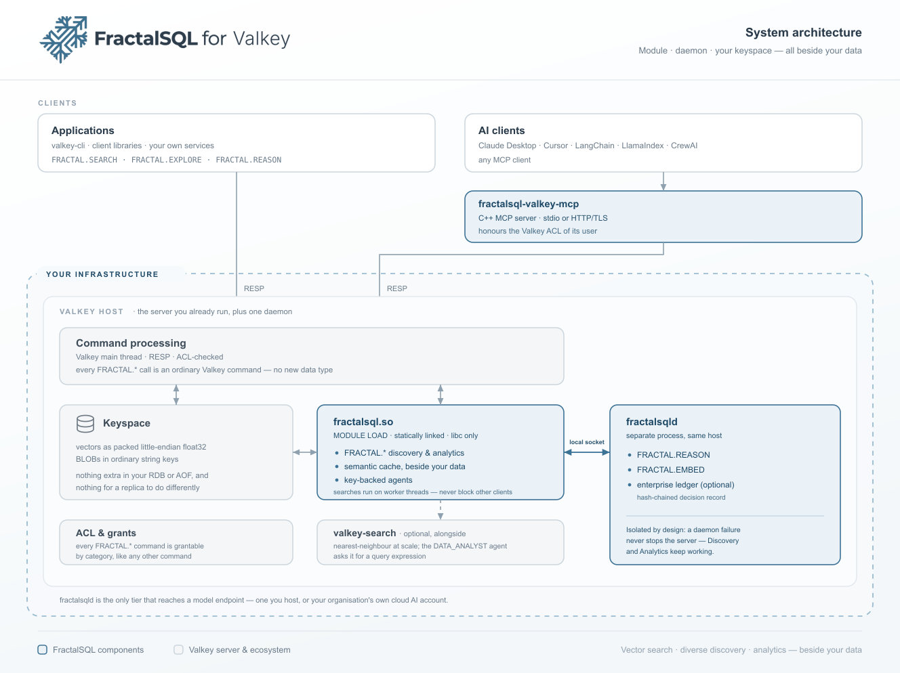

<p align="center">
  
</p>

# FractalSQL: Sovereign Data Intelligence
### AI Module for Valkey

**Vector Search. Diverse Discovery. Production-Safe Analytics. All beside your data.**

FractalSQL turns Valkey from a fast key-value store into a place where you can ask what
your vectors *mean*, and where agentic workflows can run beside your data: not only "what is closest", but "what distinct things are here", "did
this series change regime", "is this agent going around in circles". It adds what a plain
nearest-neighbour lookup structurally cannot. The search and analytics commands run inside
the Valkey process, with FractalSQL statically linked and no runtime dependency beyond libc;
reasoning and the ledger run in a separate daemon.

By keeping search, discovery, analytics and agentic workflows next to the data, FractalSQL enables
**Sovereign Data Intelligence**: the ability to reason about your data with the deployment
topology under your control. Run fully on-prem or in your own containers, with a local
model (Ollama, vLLM) for zero data egress, or point at your organisation's own cloud AI
account where your compliance posture requires it. You control the trade, not the product.

| Traditional RAG Stack | The Sovereign Way (FractalSQL) |
| --- | --- |
| **Mode Collapse**: top-K search returns near-duplicates, starving the LLM of diverse context. | **Scout Discovery**: `FRACTAL.EXPLORE` disperses a population across distinct regions of the corpus. |
| **Fragmented Logic**: app pulls vectors, calls a model, handles retries and caching in middleware. | **A semantic cache beside your data**: ask Valkey whether a similar prompt already has an answer, in-process. |
| **Blocking and fragile**: one slow search or one crashing plugin stalls or kills the datastore. | **Isolated by design**: searches run on workers and never block other clients; reasoning runs in a separate daemon. |

---

## From zero to your first search

FractalSQL's docs follow a single linear path. Each step answers one question and hands
off to the next. You don't need to read everything; follow the path.

1. **What is this and why do I care?**: you are here. Sovereign Data Intelligence, in one page.
2. **How do I get it running in 5 minutes?** → [Getting Started](docs/getting-started.md) (`docker compose up -d`, or the native `.deb`/`.rpm`/`.apk`/macOS archive, then your first Scout search).
3. **How do I apply this to my industry?** → [Starter Kits](docs/starter-kits.md): forty-four runnable, self-checking scripts, verified end to end on every build (see [demo/README.md](demo/README.md)).
4. **How does a specific command work and what are its inputs?** → the [Discovery](docs/api-discovery.md), [Analytics](docs/api-analytics.md) and [Cognition](docs/api-cognition.md) references.
5. **How do I build something that isn't in the box?** → [Composition Guide](docs/composition-guide.md): the patterns behind the kits.

> New here? Step 2 is a one-command demo. Step 4 is the reference you'll keep coming back to.

---

## 🎯 Who are you?

Depending on your role, you'll want to start in different places:

- **AI Engineer**: You want to improve RAG quality and cut model calls.
  → Start with **[docs/features.md](docs/features.md)**, the `semantic-cache` and `recommendation-search` kits, and **[docs/reasoning-setup.md](docs/reasoning-setup.md)**.
- **Platform / Security Architect**: You care about stability, blast radius and grants.
  → See **[docs/fractalsql-daemon.md](docs/fractalsql-daemon.md)** for what a failure does and doesn't do to your server, and the ACL categories in **[docs/features.md](docs/features.md#safe-by-construction)**.
- **Product Developer**: You want to build features quickly.
  → Run the **[Docker Demo](docs/docker-demo.md)**, then pick a **[Starter Kit](docs/starter-kits.md)**.

---

## 🧩 What's in the box
<p align="center">
  
</p>
Four tiers of commands (Discovery, Cognition, Agency, Analytics), composable in your application, plus an optional Enterprise ledger.

- **Discovery**: diverse, mode-collapse-free retrieval: `FRACTAL.SEARCH` (Sniper) and `FRACTAL.EXPLORE` (Scout), plus named sessions that remember what a caller rejected (`FRACTAL.DIVERSIFY.*`, `FRACTAL.FEEDBACK`, `SESSION`). See [Discovery](docs/api-discovery.md).
- **Analytics**: dimension and series primitives: `FRACTAL.DIM.DFA`/`DRIFT`/`BOXCOUNT`, `FRACTAL.SERIES.CHANGEPOINT`/`PERIODOGRAM`/`SPECTROGRAM`/`FINGERPRINT`, `FRACTAL.CYCLE.DETECT`, `FRACTAL.TDA.PERSISTENCE`, `FRACTAL.OPTIMIZE.PORTFOLIO`, `FRACTAL.MORPH.*`, and `FRACTAL.VECTOR.*` math. See [Analytics](docs/api-analytics.md).
- **Cognition**: LLM integration through the `fractalsqld` daemon: `FRACTAL.REASON` and `FRACTAL.EMBED` (Ollama, vLLM, OpenAI-compatible endpoints, your own cloud account). See [Cognition](docs/api-cognition.md).
- **Agency**: autonomous, self-correcting routines that decide from your keys: twenty-one agent commands (anomaly and regime triage, allocation, routing, outlier interception, cohort recall, diverse recommendation, loop detection, retrieve-then-reason, questions answered from a valkey-search index, and more). Each computes first and reasons last, so a model outage never costs you the numbers. See [Agency](docs/api-agency.md).
- **Enterprise**: an optional, tamper-evident decision ledger: `FRACTAL.LEDGER.*` and `FRACTAL.AUDIT.*`. See [Enterprise Tier](docs/enterprise.md).

Every command is an ordinary Valkey command. Vectors are packed little-endian float32
BLOBs in ordinary string keys, so there is no new data type, nothing extra in your RDB or AOF,
and nothing for a replica to do differently.

The question-answering agent (`DATA_ANALYST`) asks valkey-search for a query expression. FractalSQL is not a vector index either: for nearest-neighbour search
at scale use valkey-search beside it (see [Features](docs/features.md#-benchmarks--scaling)).

---

## 🚀 Get it running

The fastest path is one command. See **[Getting Started](docs/getting-started.md)**:

```bash
./build.sh amd64 && docker compose up -d   # then run your first search
```

```bash
# Or, on a real install (Linux/macOS):
valkey-cli MODULE LOAD /path/to/fractalsql.so
python3 demo/demo-vertical-semantic-cache.py --port 6379
```

Native installers: `.deb` / `.rpm` for Linux amd64/arm64, an `.apk` for musl (Alpine), and
an archive for macOS (arm64/x86_64). The floor is **glibc 2.34** (Ubuntu 22.04+, Debian 12+,
RHEL 9+). Platforms are Linux and macOS. No telemetry; everything stays local.

---

## 🏛️ Enterprise Tier

Everything above is Community edition and fully functional on its own. Discovery, Analytics
and Cognition don't depend on anything in this section. For regulated environments that need
to **prove, not just claim**, what an autonomous process decided and why, an optional drop-in
library adds a tamper-evident, hash-chained decision ledger, in the daemon rather than in your
datastore, activated by a single setting. See **[Enterprise Tier](docs/enterprise.md)** for the
full mechanism, including what the hash chain can and can't prove.

---

## 📊 Compatibility & License

| Valkey | Linux amd64 | Linux arm64 | macOS |
| --- | :---: | :---: | :---: |
| 7.2 | ✓ | ✓ | ✓ |
| 8.0 | ✓ | ✓ | ✓ |
| 8.1 | ✓ | ✓ | ✓ |

`build_test.sh` runs on every push: against Valkey 7.2.15, 8.0.12 and 8.1.11 on Linux amd64, against 7.2 on Linux
arm64, and against the `valkey` Homebrew installs on macOS (arm64 and Intel). One `fractalsql.so` (`fractalsql.dylib`
on macOS) per platform covers every supported Valkey release, because the module API (`REDISMODULE_APIVER_1`) is stable.

**License**: Apache-2.0. See `LICENSE`. Third-party components are under
their own permissive licenses (BSD-2-Clause, BSD-3-Clause, MIT, and others) --
see `THIRD-PARTY-NOTICES.md`. The module does not contain the licensed
Enterprise library; that is loaded by the daemon from a path you configure.

For enterprise editions, licensing, and support, contact **enterprise@fractalsqlabs.com**.

---

## 📚 Documentation

*Follow the path above; the links below are the same steps, expanded.*

- **[Getting Started](docs/getting-started.md)**: 60-second Docker / native install.
- **[Starter Kits](docs/starter-kits.md)**: forty-four runnable, self-checking industry scripts.
- **[Agent Recipes](docs/api-agency.md)**: the twenty-one agent commands, with real example output.
- **[Composition Guide](docs/composition-guide.md)**: build your own workflow from the commands.
- **[Features](docs/features.md)**: the full Capability Map and command index.
- **[Reasoning Setup](docs/reasoning-setup.md)**: LLM provider configuration (Ollama, vLLM, OpenAI-compatible).
- **[MCP Plugin](docs/mcp-plugin.md)**: use FractalSQL from Claude Desktop, Cursor, Windsurf, LangChain, LlamaIndex, CrewAI, and many more MCP clients.
- **[FractalSQL Daemon](docs/fractalsql-daemon.md)**: running `fractalsqld`, its config file, and what a daemon failure does (and doesn't) do to your server.
- **[Docker Demo](docs/docker-demo.md)**: a one-command end-to-end demo.
- **[Starter Kit Gallery](demo/README.md)**: the vertical demos.
- **[Enterprise Tier](docs/enterprise.md)**: the tamper-evident decision ledger (CISO/audit).

---

## 🔧 Building and testing

```bash
make                            # fractalsql.so with the vendored core
./build_test.sh                 # the whole suite; --quick, --gate N, --asan, --ubsan, --tsan, --coverage
./build.sh amd64                # the release build, in a container (glibc 2.34)
```

`build_test.sh` mirrors what CI runs and uses a private port and temp directory per run, so it
never collides with a server you already have. The daemon checks need a
`fractalsqld` binary (`--fractalsqld PATH`, or `FSQL_DAEMON`) and skip loudly without one;
the enterprise ledger checks additionally need an enterprise library (`FSQL_ENTERPRISE_LIB`),
which is never vendored here.
